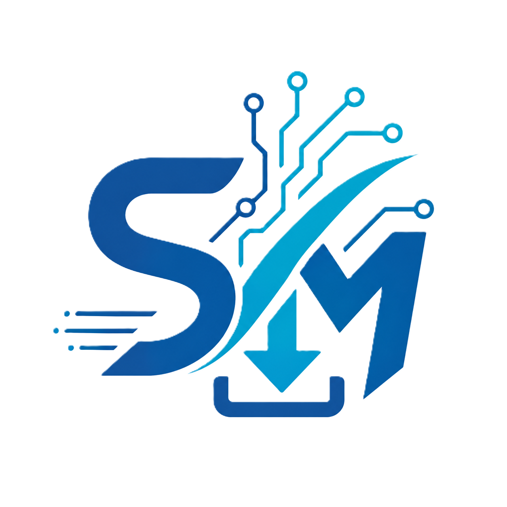

# SmartDM — High-Performance Local-First Download Manager

> **Version: C# / Avalonia (`sdm2.0`)**.
> Both product versions are preserved. Start with the [branch map](docs/BRANCHES.md),
> [current architecture](docs/CURRENT_ARCHITECTURE.md), and
> [agent resume guide](docs/implementation/RESUME_HERE.md).
> Architecture verified from local source on 2026-11-03 at `48ec34c`;
> marketing/release claims below are not fresh verification evidence.


<p align="center">
  
</p>

<p align="center">
  <strong>A modern, privacy-first, multi-threaded download manager for Windows and Linux built with .NET 9 & Avalonia UI.</strong>
</p>

<p align="center">
  <a href="https://smartdm.web.app"></a>
  <a href="https://github.com/ifahad2k/SmartDM/releases"></a>
  <a href="LICENSE"></a>
  <a href="https://dotnet.microsoft.com/"></a>
  <a href="https://avaloniaui.net/"></a>
</p>

---

## 🌟 Overview

**SmartDM** is a high-speed, local-first download manager designed to deliver maximum throughput, a modern glassmorphic interface, zero telemetry, and complete privacy. It features multi-threaded segmented downloading, seamless Chrome and Firefox browser capture, native HLS/DASH manifest parsing, YouTube discovery via YoutubeExplode, and local file organization.

**Permanent Architectural Commitments (ADR-001, ADR-003, ADR-009):**
* **Windows & Linux only**: No macOS, iOS, or Android builds.
* **One Free Edition**: Exactly one free edition. No "Pro", "Premium", or commercial tiers now or ever.
* **No Accounts or Servers**: No user registration, no license server, and no telemetry backend.
* **Local-First & Safety**: All transfers and scans run locally. Optional Gemini AI requires user consent and user's own API key.
* **No yt-dlp & No Java Runtime**: Media discovery is implemented natively (extensions + C# YoutubeExplode/HLS); FFmpeg is used strictly for stream muxing and conversions. The Java version is preserved on `main`; this C# product does not require its Java engine.

🌐 **Official Website**: [https://smartdm.web.app](https://smartdm.web.app)  
📥 **Latest Release**: [SmartDM Releases on GitHub](https://github.com/ifahad2k/SmartDM/releases)

---

## ✨ Key Features

* **⚡ Ultra-Fast Segmented Downloads**: Parallel chunk downloading, dynamic speed throttling, pause, resume, and automated retry logic.
* **🌐 Native Browser Integration**: Intercept download triggers automatically from **Google Chrome** and **Mozilla Firefox** via lightweight browser extensions and Native Messaging IPC.
* **🎥 Integrated Media Extraction**: Native HLS/DASH format ladders via SmartDM's extension format engine and YouTube stream discovery via YoutubeExplode, with FFmpeg for audio/video muxing.
* **🪟 Independent Top-Level Windows**: Dialogs run in independent OS windows with their own taskbar controls so you can work friction-free.
* **🔒 Privacy & Local Encryption**: Local SQLite history (currently unencrypted; SQLCipher migration is pending). No user accounts, cloud sync, telemetry, or remote tracking.
* **📁 Smart Category Organization**: Auto-categorizes incoming files into Music, Videos, Documents, Software, and Archives based on extension and mime-type.

---

## 🚀 Quick Launch (Desktop Application)

The supported desktop application is the C#/.NET 9 Avalonia client located in `apps/desktop-avalonia`:

### Windows
```cmd
run-app.bat
```
or via PowerShell:
```powershell
.\run-app.ps1
```

### Linux development checkout

Use the current C# branch and the Avalonia project entry point with the .NET 9
SDK/runtime available:

```bash
git clone --branch sdm2.0 --single-branch https://github.com/ifahad2k/SmartDM.git
cd SmartDM
dotnet run --project apps/desktop-avalonia/SmartDm.Desktop.Avalonia.csproj
```

For an existing checkout, fetch and fast-forward the branch before running it:

```bash
git fetch origin
git switch sdm2.0
git pull --ff-only origin sdm2.0
```

`sdm-v2` is also synchronized to this development snapshot at the owner's request.
The Java application remains on `main`. Repository-root Gradle launch tasks refer
to the preserved Java application. Current test evidence and remaining development
limitations are recorded in [the synchronization handoff](docs/implementation/BRANCH_SYNC_HANDOFF.md).

---

## 🧩 Browser Extension Setup Guide

SmartDM integrates directly with your browser to catch links automatically.

### 🌐 Google Chrome Setup

1. Open Chrome and navigate to `chrome://extensions/`.
2. Enable **Developer mode** (toggle switch in the top-right corner).
3. Click **Load unpacked**.
4. Select the Chrome Extension folder:
   * Installed location: `%LocalAppData%\SmartDM\extensions\chrome`
   * Portable location: `<SmartDM-Folder>/extensions/chrome`
5. Open SmartDM Settings -> **Browser Integration** -> Click **Install / Register Native Host**.

---

### 🦊 Mozilla Firefox Setup

1. Open Firefox and navigate to `about:debugging#/runtime/this-firefox`.
2. Click **Load Temporary Add-on...**.
3. Select `manifest.json` inside the Firefox Extension folder:
   * Installed location: `%LocalAppData%\SmartDM\extensions\firefox\manifest.json`
   * Portable location: `<SmartDM-Folder>/extensions/firefox/manifest.json`
4. Open SmartDM Settings -> **Browser Integration** -> Click **Install / Register Native Host**.

---

## 🛠️ Technology Stack & Architecture

SmartDM on branch `sdm2.0` is governed by [ADR-009](docs/adr/ADR-009-sdm2-csharp-avalonia-architecture.md):

* **Primary Desktop Product**: C# (.NET 9) with Avalonia UI (v11.2) in `apps/desktop-avalonia`
* **Target Boundaries (planned, not the current project split)**:
  * `SmartDm.Domain` — Models, states, domain rules (isolated from UI, DB, HTTP, OS APIs)
  * `SmartDm.Application` — Use cases, interfaces, and ports
  * `SmartDm.Download` — HTTP probe, segmentation, transfer journal, atomic finalization
  * `SmartDm.Persistence` — SQLCipher encrypted storage and versioned migrations
  * `SmartDm.Browser` — Native messaging and authenticated capture protocol
  * `SmartDm.Safety` — Threat evidence, scanner adapters, quarantine management
  * `SmartDm.Media` — Media metadata, YouTube/HLS resolvers, FFmpeg adapter
  * `SmartDm.Desktop` — Avalonia MVVM views, viewmodels, composition root
* **Media Discovery**:
  * Chrome & Firefox `format_engine.js`: in-browser HLS & DASH manifest parsing
  * `YouTubeMediaResolver.cs`: YouTube format discovery via YoutubeExplode (no yt-dlp)
  * `HlsMediaResolver.cs`: Native C# HLS stream discovery with platform TLS validation
  * `FFmpeg`: Subprocess adapter for stream remuxing and audio/video combining
* **Preserved Java Version**: `main` maintains the Java/JavaFX product. The C# app uses its own DownloadEngine; Java modules in this checkout are preserved, not its production engine.

---

## 🔧 Building From Source

### Prerequisites

* [.NET 9 SDK](https://dotnet.microsoft.com/download/dotnet/9.0) (9.0.x)
* Git

### C# / .NET 9 Build & Test (Supported Product)

```powershell
# Restore dependencies
dotnet restore SmartDm.sln

# Build solution
dotnet build SmartDm.sln --no-restore

# Run automated tests (including Architecture boundary and TLS validation tests)
dotnet test SmartDm.sln --no-build

# Run desktop application
dotnet run --project apps/desktop-avalonia
```

---

## 📄 License & Open Source

This project is licensed under the **[GNU General Public License v3.0 (GPLv3)](LICENSE)**.

```
Copyright (C) 2026 SmartDM Contributors / ifahad2k

Everyone is permitted to copy and distribute verbatim copies
of this license document, but changing it is not allowed.
```

See [LICENSE](LICENSE) for the full license text.

---

<p align="center">
  Made with ❤️ by <a href="https://github.com/ifahad2k">ifahad2k</a> & SmartDM Contributors.  
  Visit <a href="https://smartdm.web.app">smartdm.web.app</a> for more information.
</p>
