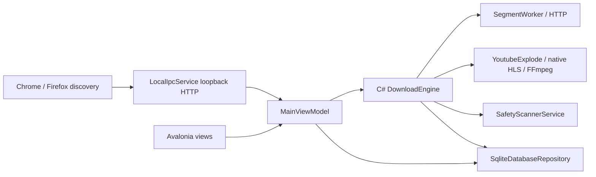

# Current architecture — C# version

Updated 2026-11-06: the implementation below and dated follow-ups are included in
the C# source snapshot published as `fb945a7` to `sdm2.0` and `sdm-v2`.
See [branch ownership](BRANCHES.md) and the latest publication handoff. Earlier
dated observations remain historical; target architecture is still separate.

## Actual project structure

| Path | Implemented role |
| --- | --- |
| `apps/desktop-avalonia/Program.cs` | Process entry, single-instance activation and diagnostic modes |
| `apps/desktop-avalonia/App.axaml.cs` | Avalonia startup, window wiring, theme and snapshot modes |
| `apps/desktop-avalonia/ViewModels/MainViewModel.cs` | Creates default services, loads history, starts local IPC and coordinates queue/UI actions |
| `apps/desktop-avalonia/Services/DownloadEngine.cs` | Production transfer engine: HTTP segments, recovery, staging/finalization and media processing |
| `apps/desktop-avalonia/Services/SegmentWorker.cs` | Range workers and transfer/retry handling |
| `apps/desktop-avalonia/Services/SqliteDatabaseRepository.cs` | Microsoft.Data.Sqlite history and versioned migrations; currently unencrypted |
| `apps/desktop-avalonia/Services/LocalIpcService.cs` | Loopback HttpListener browser handoff; security gaps remain |
| `apps/desktop-avalonia/Services/YouTubeMediaResolver.cs` | YoutubeExplode discovery |
| `apps/desktop-avalonia/Services/HlsMediaResolver.cs` | Native HLS discovery with platform TLS |
| `apps/desktop-avalonia/Services/SafetyScannerService.cs` | Scanner/hash/heuristic implementation; do not assume missing evidence means clean |
| `apps/desktop-avalonia/Views`, `ViewModels`, `Models`, `Controls` | Current Avalonia MVVM presentation and local service contracts |
| `src/SmartDm.Domain` | Small independent domain project (state, verdict and credentials types) |
| `src/SmartDm.Application` | Small ports project, currently ISecretStore; references Domain |
| `tests/SmartDm.Architecture.Tests` | Architecture, TLS, engine, integrity and presentation regression tests |
| `extensions/{chrome,firefox}` | Browser-specific manifests, background discovery, sniffer and overlay modules |
| `smartdm-website` | Separate React/TypeScript/Vite/Firebase site; website accounts are not desktop accounts |
| `apps/desktop`, Java `modules`, Gradle | Preserved Java sources; not C# production transfer composition |

Most C# implementation still lives inside the desktop project. The planned
SmartDm.Download/Persistence/Browser/Safety/Media assemblies do not exist as separate
projects today. The desktop csproj has no ProjectReference to Domain/Application.
Do not draw the target layer diagram as if the extraction has already happened.
`SmartDm.sln` also includes the audit Repro project; this is not another product.

## Runtime flow



MainViewModel defaults to `new DownloadEngine(repository, scanner)`.
`IpcDownloadEngine`, `EngineDaemonLauncher` and Java IPC client remain legacy code;
they are not the default engine. Preserve Java as its own version on `main`.
Browser `modules/format_engine.js` means a file inside **each extension directory**,
not a root-level `modules/format_engine.js` file. Follow each manifest's script order.
Do not deduplicate those copies without a packaging/build change and browser tests.
FFmpeg is external media processing; C# discovery does not invoke yt-dlp.

## Run and verify

.NET SDK 9 required. Windows: `run-app.bat` or `./run-app.ps1`.
Both Windows and Linux from source: `dotnet run --project apps/desktop-avalonia`.
`run_smartdm.bat` opens an already-built Debug executable and may therefore be stale.

```powershell
dotnet restore SmartDm.sln
dotnet build SmartDm.sln --no-restore
dotnet test SmartDm.sln --no-build
node --test tests/browser/*.test.cjs
```

Website: in `smartdm-website`, use `npm ci`, `npm run build`, and
`node --test tests/auth-cleanup.cjs`. Do not deploy or bootstrap admin accounts as
part of a local cleanup. Snapshot mode is `--snapshot`; output defaults to the temp
SmartDM/snapshots directory, overridable with `SMARTDM_SNAPSHOT_DIR`.

## Current limits and proof

2026-11-03 Package 2 follow-up: ordinary transfer creation now carries probed ETag,
Last-Modified and nullable range capability into history. Migration 4 adds
`supports_ranges`; migration statements and ledger entries are transactional.
Advertised range support is checked with a one-byte GET. Explicit non-range
downloads use a fresh full-body GET with exact known-length validation. The
aggregate limiter supports reads larger than its bucket. Collision choices now
reach engine policy. See `implementation/PACKAGE2_RELIABILITY_HANDOFF.md`.
Latest local result: 93 .NET tests and 8 browser tests pass; build has no warnings
or errors. No new Linux, live-site, installer or throughput comparison proof.

The subsequent [lifecycle slice](implementation/PACKAGE2_LIFECYCLE_HANDOFF.md)
adds a per-download command gate and one owning runner from reservation through
cleanup. Setup runs off the UI thread; pause/cancel await workers, monitors,
scanners and child-process shutdown rather than handing off after 800 ms.
Finalization arbitrates stop versus commit explicitly. The 12 new lifecycle
cases exercise ordinary HTTP transfers; real FFmpeg/Linux lifecycle proof remains
outstanding. A noncooperative operation can keep a stop pending; ownership is
retained instead of starting another writer.

Package 2 remains open. Recovery validator races and aggregate limiter interactions
need real-boundary verification. SQLite encryption, secrets/cookies and loopback
handoff authentication remain Package 3 work. Facebook selected-player identity is
protected by tests, but live extraction compatibility is not proven for every page.
Scanner evidence and release installer hardening remain open. See KNOWN_LIMITATIONS.

Earlier local cleanup verification: 54 .NET tests, 8 browser tests, 13 mocked website auth
tests passed; desktop and website builds passed. These are local Windows results,
not Linux/remote CI or live Facebook/Firebase proof. Gradle checks in this checkout
passed from cache and do not establish the Java branch's current verification.


## 2026-11-03 selected-social and filename follow-up

See `implementation/SOCIAL_MEDIA_FOLLOWUP.md` for partial user defect repairs: 97 .NET and 22 browser tests passed. Encoded filenames, selected-source isolation and bounded overlay positioning have regression checks. Gotaku/Reanime live failures, opaque X source binding, complete quality discovery and loaded-browser verification remain open. Package gate remains NO; running app has not been restarted into the new build.


## 2026-11-04 Goals 3/4 runtime implementation

See [runtime handoff](implementation/GOALS_3_4_HANDOFF.md). Added bounded transfer scheduling, HLS validator/hash checkpoints and sibling failure cancellation, exact media identity/refresh, output-track validation, explicit persisted safety evidence/quarantine, guarded destination/address operations, verified archive update preparation, atomic settings and diagnostic profile isolation. Normal history is virtualized. Migrations 7/8 are additive. Latest local evidence: 156 .NET (including two opt-in real FFmpeg tests), 40 browser fixtures; build zero warnings/errors. Full Package 4/5 gates remain NO; installer/release creation is deferred by the owner. Existing Package 3 encryption/authentication gaps remain. This maps implemented behavior, not future architecture.


## 2026-11-04 extension resource lifecycle

Chrome/Firefox overlays now share constructed CSS where supported, prune disconnected
players/cards and release their listeners/observers/polls. Discovery caches prune on
insertion, Facebook cache has a 20-entry cap, and polls share pending lookups. Sniffer
clone reads and in-page HLS probes are bounded; player-decoded snapshots refresh
without generic reprobes. See [handoff](implementation/EXTENSION_MEMORY_HANDOFF.md)
for exact limits, 66 browser tests and remaining live-memory validation. These are
implemented lifecycle changes, not measured Chrome RAM savings or closed gates.


## 2026-11-06 synchronized C# development snapshot

The [publication handoff](implementation/BRANCH_SYNC_HANDOFF.md) records the current
UI/engine/browser scope and latest verification. Native AES-128 HLS, shared HTTP/2
negotiation, weak-map MSE association and latest-menu snapshot handoff are now in
source. Firefox-specific manifest/host metadata is restored. Both C# branch names
are owner-authorized synchronization targets; Java main remains preserved. Local
verification: 177 .NET, 77 browser and 13 auth tests; package gates remain NO.

Remote CI follow-up: Ubuntu C# build/tests and browser fixtures passed in run
42264399155. The preserved Java cold build hit an incomplete dependency checksum
entry; Windows build passed before matrix cancellation. Platforms now finish
independently (`fail-fast: false`); dependency verification remains enforced.
The Windows collision fixture now joins runner shutdown before staging deletion;
this is test lifecycle synchronization, not a production architecture change.

## 2026-11-06 streamed MediaSource association

Both sniffers now follow the player's existing streamed response reads and byte
copies, with bounded exact MP4 payload sample matching across copied/remuxed data.
Player/source identity and observed audio pairing remain required; no tab-wide
latest-media guess was restored. Caps, invalidation behavior and actual two-clip
Chrome download evidence are in [handoff](implementation/STREAM_BINDING_HANDOFF.md).
This is shared browser implementation; desktop transport and schemas are unchanged.
